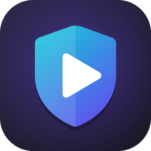
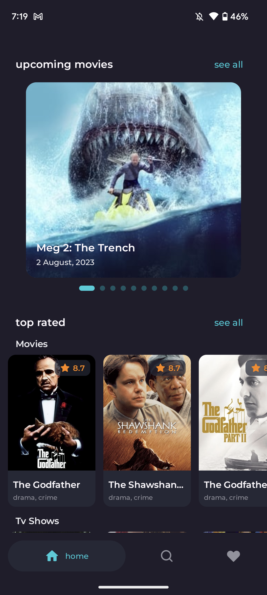

<p align="center">
  
</p>

<h1 align="center">NoFlix – Watch Movies &amp; TV Series Ad-Free on Android</h1>

<p align="center">
  <b>A free, open-source Android app to stream movies and TV shows with no ads, no pop-ups and no trackers.</b><br/>
  Built-in ad blocker · Full-screen player · No sign-up · Made with Kotlin Multiplatform &amp; Compose Multiplatform (Jetpack Compose)
</p>

<p align="center">
  <a href="https://github.com/zobaer53/NoFlix/releases/latest/download/NoFlix.apk"></a>
  <a href="https://zobaer53.github.io/NoFlix/"></a>
</p>

<p align="center">
  <a href="https://github.com/zobaer53/NoFlix/releases/latest"></a>
  <a href="https://github.com/zobaer53/NoFlix/releases"></a>
  <a href="https://android-arsenal.com/api?level=26"></a>
  <a href="LICENSE.txt"></a>
  <a href="https://github.com/zobaer53/NoFlix/stargazers"></a>
</p>

.png>)

## What is NoFlix?

**NoFlix** is an **ad-free movie and TV series streaming app for Android**. Browse trending, popular, top-rated and upcoming movies and TV shows, read the details, save favourites to your watchlist, and press **Play** to watch in a clean, full-screen player. Ads, pop-ups, redirects and trackers are blocked with a built-in ad blocker.

If you've been looking for a way to **watch free movies without ads**, **stream TV series without pop-ups**, or find a **Netflix-style app without ads** that is free and open source, NoFlix is for you.

## Features

- 🚫 **Ad-free streaming.** A built-in ad blocker (AdGuard / EasyPrivacy filter lists and a native ad-block engine) removes ads, pop-ups, redirects and crypto-miners.
- 🎬 **Movies and TV series.** Trending, popular, top-rated, now playing, upcoming and discover lists, powered by [The Movie Database (TMDB)](https://www.themoviedb.org/).
- ▶️ **One-tap full-screen player.** Videos open in landscape full screen; the rest of the app stays portrait.
- 🔍 **Search and filters.** Search by title, or filter movies and TV shows by genre, year, rating, language, runtime, country, age rating, streaming service and TV network, and sort the results.
- 🎞️ **Trailers.** Play a movie's or series' YouTube trailer from its details page.
- ❤️ **Watchlist.** Save movies and series to watch later.
- 📶 **Offline browsing.** Lists and details are cached, so you can browse without a connection.
- 🔒 **Private.** No account, no sign-up, no analytics.
- 🎨 **Modern design.** Material 3, dark theme and a smooth Compose Multiplatform UI.
- ⚡ **Small and fast.** The release APK is about 8 MB and starts in under 200 ms on a Pixel 6a. A Baseline Profile makes the first launches after an install about 40% faster.

## Download

Get the latest signed APK from **[GitHub Releases](https://github.com/zobaer53/NoFlix/releases/latest)**. Every update on `master` is published there automatically.

1. Download `NoFlix.apk` on your Android phone (Android 8.0 or newer).
2. Open it and allow *Install unknown apps* if prompted.
3. Open NoFlix, pick a movie or series and tap **Play**.

## Demo

https://github.com/zobaer53/zeDMoviesApp/assets/61627836/3743cf43-8afc-4984-b392-b425784ef823

## Screenshots

<table width="100%">
  <tbody>
    <tr>
      <td width="25%"></td>
      <td width="25%"></td>
      <td width="25%"></td>
      <td width="25%"></td>
    </tr>
  </tbody>
</table>

## FAQ

**Is NoFlix free?**
Yes. NoFlix is completely free and open source under the Apache 2.0 license, and it has no ads or in-app purchases.

**How do I watch movies without ads on Android?**
Install NoFlix, search for a movie or TV show and tap Play. The built-in ad blocker filters every request the player makes, so ads and pop-ups never load.

**Do I need an account?**
No. NoFlix works without sign-up or login.

**Is NoFlix on the Google Play Store?**
No. Download the APK from [GitHub Releases](https://github.com/zobaer53/NoFlix/releases/latest).

**Does NoFlix host any videos?**
No. See the [disclaimer](#disclaimer) below.

## Tech stack & architecture

NoFlix is a Kotlin Multiplatform project. It follows the [official Android architecture guidance](https://developer.android.com/topic/architecture) (data, domain and UI layers):


### Modules

- **`:shared`** (Kotlin Multiplatform) holds almost the whole app:
  - `commonMain`: domain (models, repository interfaces, use cases), data (TMDB API, Room database, DataStore, repositories, paging), the Koin modules, the ViewModels, navigation and the whole Compose UI with its strings, fonts and images (`composeResources`).
  - `androidMain`: the Android parts: Room on the platform SQLite, the DataStore file, the OkHttp engine, device locale and region, system bar icons and date formatting.
  - `jvmMain`: the same parts for the JVM target (Room on the bundled SQLite).
  - `commonTest` and `jvmTest`: tests that run on the host.
- **`:app`** is a thin Android shell: the activity and application class, the WebView player, the trailer player, `AndroidMediaLauncher` (starts both players from the shared UI) and the TMDB API key from `local.properties`.
- **`:ad-filter`** downloads and installs the filter lists (WorkManager) and blocks requests and page elements in the WebView.
- **`:adblock-client`** wraps Brave's C++ ad-block engine through JNI.
- **`:baselineprofile`** generates the app's Baseline Profile and measures cold start (Macrobenchmark). It is a test module and isn't shipped.

The JVM target exists only to run tests on the host and to keep Android APIs out of `commonMain`. There is no desktop app.

### Libraries

- **Kotlin**, **Coroutines & Flow**
- **Kotlin Multiplatform**: domain, data, ViewModels and UI live in the `:shared` module (Android, plus a JVM target for host tests)
- **Compose Multiplatform** (Jetpack Compose on Android), Material 3, and **Compose resources** for strings, fonts and images
- **Navigation Compose** (multiplatform) for the screens, **Lifecycle ViewModel** for their state
- **Koin** for dependency injection
- **Ktor** (OkHttp engine) + **kotlinx.serialization** for the TMDB API
- **Room** (KMP) + **Paging 3** (RemoteMediator) cache lists and details for offline browsing; search and filtered discover page straight from the network
- **DataStore** (Preferences) stores the content language
- **Coil 3** loads the images, through Ktor
- **WebView** with an AdGuard-compatible ad-blocking engine (C++ via JNI) for playback, and **android-youtube-player** (YouTube's IFrame player) for trailers
- **R8** shrinks and optimizes the release build: the APK went from 18 MB to under 8 MB, and cold start got about a quarter faster (174 ms median on a Pixel 6a)
- **Baseline Profile** (`:baselineprofile`, ProfileInstaller) precompiles the startup path: in a cold-start macrobenchmark on a fresh install, the median dropped from 369 ms to 224 ms

## Build from source

1. Clone the repo and open it in Android Studio.
2. Get a free API key from [The Movie DB](https://www.themoviedb.org/settings/api) and add it to `local.properties`:
   ```properties
   API_KEY=yourApiKey
   ```
3. Install **CMake 3.22.1** and **NDK 28.2.13676358** (r28c) from *SDK Manager → SDK Tools*. The native ad-block library needs them. You also need JDK 17 or newer.
4. Run `./gradlew :app:installDebug` or press Run in Android Studio.
5. For a release build, run `./gradlew :app:assembleRelease`. R8 minifies it. To sign it, add `RELEASE_STORE_FILE`, `RELEASE_STORE_PASSWORD`, `RELEASE_KEY_ALIAS` and `RELEASE_KEY_PASSWORD` to `local.properties`; without them the APK is unsigned.

### Tests

```bash
./gradlew :shared:jvmTest              # :shared's tests on the JVM: data layer, Room DAOs and migration, Koin graph, screens
./gradlew :app:testDebugUnitTest       # :app's JVM tests (Koin graph; renders the screenshot tests without comparing)
./gradlew :app:verifyRoborazziDebug    # screenshot tests: compares each screen with app/src/test/screenshots/
scripts/kmp-guard.sh                   # checks that shared/src/commonMain uses no Android or JVM APIs
.maestro/run.sh                        # builds and clean-installs the debug app, then runs the Maestro UI suite
./gradlew :app:generateBaselineProfile # regenerates the Baseline Profile on a connected device
```

**Note:** `.maestro/run.sh` uninstalls NoFlix from the device before it installs the debug build. The debug and release builds share the same app id, so running it on a phone with NoFlix from Releases deletes that install and its watchlist. With several devices attached, set `ANDROID_SERIAL` first.

## Contributing

Issues and pull requests are welcome. If NoFlix helps you watch movies and TV series without ads, please ⭐ **star the repo**. It helps other people find it.

## Disclaimer

NoFlix does not host, upload or store any video files. Movie and TV metadata comes from the TMDB API, and playback loads publicly available third-party web pages. NoFlix is not endorsed or certified by TMDB. You are responsible for complying with the laws in your country.

## Credits

- UI design from [Figma Community](https://www.figma.com/community/file/1088719884686291024)
- Ad blocking based on [AdblockAndroid](https://github.com/Edsuns/AdblockAndroid), [AdGuard filters](https://github.com/AdguardTeam/AdguardFilters) and Brave's ad-block engine
- Movie and TV data from [TMDB](https://www.themoviedb.org/)

## Contact

📫 **hossain.zobaer11858@gmail.com**

<p align="left">
<a href="https://www.linkedin.com/in/zobaer53/" target="blank"></a>
<a href="https://medium.com/@zobaer53" target="blank"></a>
<a href="https://www.hackerrank.com/zobaer53" target="blank"></a>
<a href="https://www.sololearn.com/profile/15909016" target="blank"></a>
<a href="https://stackoverflow.com/users/zobaer-hossain" target="blank"></a>
</p>

## License

```
Copyright 2023 zobaer53 (Zobaer Hossain)

Licensed under the Apache License, Version 2.0 (the "License");
you may not use this file except in compliance with the License.
You may obtain a copy of the License at

   http://www.apache.org/licenses/LICENSE-2.0

Unless required by applicable law or agreed to in writing, software
distributed under the License is distributed on an "AS IS" BASIS,
WITHOUT WARRANTIES OR CONDITIONS OF ANY KIND, either express or implied.
See the License for the specific language governing permissions and
limitations under the License.
```

<!-- Keywords: ad free movies app, ad-free TV series app, watch movies without ads, free movie streaming app Android, no ads movie app APK, adblock movie player, open source Netflix alternative, Kotlin Jetpack Compose movie app, Kotlin Multiplatform movie app, Compose Multiplatform app, TMDB movie app -->
